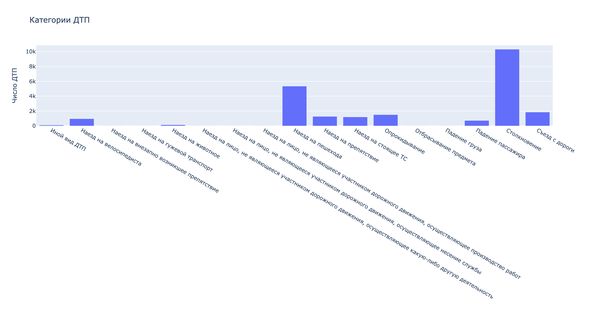
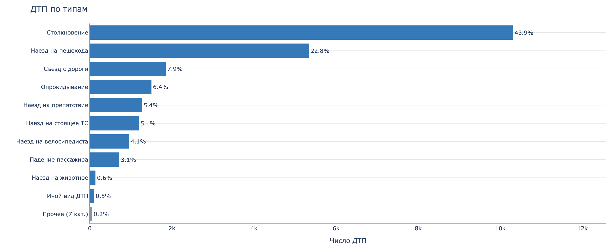

# Анализ данных о ДТП во Владимирской области

Автор / GitHub: camel-1984 · Регион: Владимирская область · Период: 01.01.2015 – 31.01.2026

## Данные и подготовка

**Источник.** Проект «Карты ДТП», https://dtp-stat.ru/opendata/, выгрузка по Владимирской области.

| | |
|---|---|
| Файл | `vladimirskaia-oblast.geojson` (GeoJSON FeatureCollection, 51.5 МБ) |
| SHA-256 | `e7a5b8a386fe9fabd9858c9b7c43af0031927bdf4199b0c62d9cd53cac73f9e7` |
| Дата импорта | 2026-09-10 |
| Записей | 23 485 |
| Период | 01.01.2015 03:45 — 31.01.2026 21:33 |

**Единицы анализа.**

| Единица | Объём | Чем получается | Где используется |
|---|---|---|---|
| ДТП | 23 485 | [`data_loading.record_to_full_frame`](data_loading.py) | динамика, структура, карта, гипотеза 1 |
| Транспортное средство | 40 203 | [`eda.vehicle_frame`](eda.py) | гипотеза 2 |
| Участник | 59 478 | [`eda.participants_frame`](eda.py) | структура участников |
| Водитель со стажем и известным исходом | 34 347 | [`hypotheses.driver_outcomes`](hypotheses.py) | гипотеза 3 |
| Гексагон H3 (r = 6, ≥ 30 ДТП) | 139 | [`pca_tsne.h3_to_pca`](pca_tsne.py) | PCA, t-SNE |

**Общая оценка.**

Три главных кадра (ДТП, транспортные средства, участники) прогоняются через [`eda.eda_base`](eda.py): по каждому столбцу видно тип, число уникальных и заполненных значений, число пропусков. Выгрузка оказалась полной и аккуратной: в полях, которые используются в работе, пропусков практически нет, даты разобраны все до единой, координаты продублированы двумя способами и совпадают между собой, полных дубликатов нет. Незначительные помехи, которые всё-таки нашлись, на объёме в 23 485 записей не меняют ни один из приведённых разрезов и ни одну из проверок, поэтому отдельная чистка не потребовалась.

Существенное ограничение выгрузки в другом: она описывает только сами происшествия и ничего не говорит о дорожной обстановке: интенсивности движения, числе машин на дороге. Поэтому по ней можно сравнивать состав и тяжесть ДТП, но нельзя оценивать риск и делать выводы о том, что происходит на дорогах за пределами зарегистрированных происшествий.

**Поля.**

**Уровень ДТП** (`properties` каждой записи GeoJSON):

| Поле | Что означает | Значения и единицы |
|---|---|---|
| `id` | идентификатор происшествия в источнике | целое, уникально для каждой записи |
| `gibdd_number` | номер карточки учёта ГИБДД | строка, уникальна |
| `datetime` | дата и время начала ДТП | с точностью до минуты |
| `region` | муниципальное образование: город или район | 21 значение |
| `parent_region` | вышестоящая территория | пусто, если ДТП отнесено к области целиком |
| `address` | адрес текстом | строка |
| `category` | тип происшествия | 17 значений: столкновение, наезд на пешехода, съезд с дороги и т. д. |
| `severity` | тяжесть последствий | 3 градации: «Легкий», «Тяжёлый», «С погибшими» |
| `light` | условия освещения | 5 значений: светлое время, сумерки, темнота с включённым освещением, темнота без освещения, темнота с невключённым освещением |
| `weather` | погода | список строк, значений может быть несколько |
| `road_conditions` | состояние проезжей части | список строк |
| `nearby` | объекты рядом с местом ДТП | список строк: перекрёсток, перегон, объекты притяжения |
| `scheme` | код схемы происшествия | целое |
| `participant_categories` | категории участников происшествия | список строк |
| `tags` | метки источника | список строк, в этой выгрузке всегда одна |
| `dead_count` | погибло | человек |
| `injured_count` | ранено | человек |
| `participants_count` | всего участников | человек |
| `geometry.coordinates` | координаты точки ДТП | GeoJSON Point, порядок `[долгота, широта]`, градусы WGS 84 |
| `point` | те же координаты в собственном формате источника | объект `{"lat": …, "long": …}`, градусы |

**Уровень транспортного средства** (`vehicles[]`, 40 203 записи):

| Поле | Что означает | Значения и единицы |
|---|---|---|
| `brand` | марка | 235 значений, включая сводную категорию «Прочие марки ТС» |
| `model` | модель | строка |
| `color` | цвет | строка |
| `year` | год выпуска | целое; встречаются заведомо ошибочные значения вплоть до 1, в расчётах не используется |
| `category` | класс ТС | строка вида «B-класс (малый) до 3,9 м», «Седельные тягачи» |

**Уровень участника** (`vehicles[].participants[]` и `participants[]`, 59 478 записей):

| Поле | Что означает | Значения и единицы |
|---|---|---|
| `role` | роль в происшествии | 13 значений: водитель, пассажир, пешеход, велосипедист и другие |
| `gender` | пол | «Мужской», «Женский», «Не определен» |
| `years_of_driving_experience` | стаж вождения | полные годы; коды 95, 96 и 99 служебные и исключаются |
| `health_status` | состояние здоровья после ДТП | 41 формулировка: не пострадал, три степени ранения и смерть с указанием срока — от «на месте ДТП» до «в течение 30 суток» |
| `violations` | нарушения, вменённые участнику | список строк |

**Что проверено в данных**

- *Даты.* Все 23 485 значений разобраны, будущих и слишком старых нет. Период сплошной: 133 календарных месяца подряд, пустых месяцев нет.
- *Координаты хранятся дважды.* Есть `geometry.coordinates` в порядке «долгота, широта» и `point` с ключами `lat` и `long`. Поля совпадают во всех 23 485 записях, ноль расхождений, так что порядок координат подтверждается сам собой. В рабочем кадре [`data_loading.full_frame_to_app`](data_loading.py) они сводятся в `latitude` и `longitude`: берётся `geometry`, при пустом значении `point`. Без координат 1 запись, за пределами полигона границы 127. Прямоугольная рамка ловит только 32 из них, то есть 95 точек лежат внутри рамки, но вне области. На карте показываются 23 357 записей, остальные перечислены в подписи под ней.
- *Участники лежат в двух местах.* Ехавшие в машине хранятся внутри `vehicles[].participants[]` (53 579 человек), остальные в списке `participants[]` на уровне ДТП (5 899 человек). [`eda.participants_frame`](eda.py) разворачивает оба списка в одну таблицу, помечает происхождение флагом `in_vehicle` и сохраняет `source_id` с индексом машины. Это же защищает от двойного учёта: агрегаты по участникам не смешиваются с агрегатами по ДТП, а фильтры дашборда переносятся через `source_id`. Для гипотезы о марках берутся участники с `in_vehicle = True`, объединённые с таблицей ТС по паре `source_id` и `vehicle_idx`.
- *Дубликаты.* Полных дубликатов нет. Две записи совпадают одновременно по координатам и времени; они оставлены как есть, на результаты такая пара не влияет.
- *Пропуски в полях, которые не используются.* `address` пуст в 642 записях, `parent_region` в 8 339. Второе число совпадает с числом записей, где `region = «Владимирская область»`: поле не заполняется, когда ДТП не привязано к городу или району.
- *Служебные и недостоверные значения.* Коды стажа 95, 96 и 99 исключены из всех расчётов по стажу. В годе выпуска ТС встречаются значения вплоть до 1, поэтому поле не используется.

**Граница региона.** Точки внутри области отделяет отдельный файл [`assets/vladimir_boundary.geojson`](assets/vladimir_boundary.geojson): один замкнутый контур из 8 643 вершин. Проверка идёт по полигону, а не по прямоугольнику. [`geo.region_mask`](geo.py) сначала грубо отсекает точки по габаритной рамке ради скорости, затем считает точное вхождение в контур средствами geopandas. Упрощённый вариант с одной рамкой в коде тоже остался, [`utils.check_coords`](utils.py) с диапазонами 55–57° с. ш. и 38–43° в. д., но он использовался только на этапе разведки: рамка шире области и захватывает куски соседних регионов.

## Исследовательские вопросы

Разведка шла в три захода, по ноутбуку на шаг: [`eda_one.ipynb`](eda_one.ipynb) с общим обзором выгрузки, [`eda_two.ipynb`](eda_two.ipynb) с распределениями основных признаков, [`eda_three.ipynb`](eda_three.ipynb) с проверкой вопросов.

**Что лежит в данных.** Обзор трёх кадров через [`eda.eda_base`](eda.py), проверка координат через [`utils.missing_coords`](utils.py) и [`utils.check_geom_point`](utils.py), разворачивание списков машин и участников. Здесь же нашлась первая проблема: в сыром распределении стажа ([`eda.years_of_driving_exp_raw`](eda.py)) торчат значения 95 (2 197 водителей), 96 (240) и 99 (792). Это служебные коды, а не стаж, и 3 229 записей из 37 577 исключены: иначе «водители со стажем 99 лет» тянут на себя весь правый хвост распределения.

**Как распределены ДТП во времени.** 23 485 происшествий за 133 месяца, в среднем 177 в месяц, помесячный ряд со скользящим средним за 12 месяцев на [`month_line.png`](figures/plotly/month_line.png). В ряду смешаны две независимые вещи.

*Спад.* По годам: 2 727 в 2015, 2 290 в 2019, 1 848 в 2021, дальше полка на уровне 1 757, 1 821, 1 852, 1 847. Падение от 2015 к 2021 составило 32%, последние пять лет уровень держится. Именно спад показывает красная линия скользящего среднего: усреднение по 12 месяцам убирает сезонность.

*Сезонность.* При усреднении по календарным месяцам за 11 полных лет (2015–2025) картина устойчивая: минимум в феврале, 119 ДТП в среднем за месяц, максимум в августе, 226, то есть почти вдвое больше. Летние месяцы дают 219 ДТП против 154 зимой, отношение 1.42. Это не особенность отдельного года: пик приходится на июль или август в 9 годах из 11, минимум на февраль или март тоже в 9 из 11. Декабрь выделяется отдельно (192), он выше ноября и января.

*Чем это объясняется, предположение, а не вывод.* Летом больше поездок, появляются мотоциклисты и велосипедисты, растёт число загородных выездов; зимой поездок меньше, скорости ниже. По выгрузке это не проверяется: данных о транспортном потоке в ней нет. Она говорит только о том, что летом регистрируется больше происшествий, но не о том, что летом опаснее ездить.

**Как выглядят остальные признаки.**

- *Недельный ритм.* Тепловая карта по дням недели и часам ([`week_hour_heatmap.png`](figures/plotly/week_hour_heatmap.png)) показывает пик в пятницу в 17 часов, 277 ДТП за все годы. Разброс по дням умеренный, но заметный: суббота 3 806 против вторника 3 076, на 24% больше.
- *Типы происшествий.* Столкновение 43.9%, наезд на пешехода 22.8%, съезд с дороги 7.9%, опрокидывание 6.4%. Семь редких типов собраны в сводную группу, иначе хвост из единичных значений растягивает график ([`categories_after.png`](figures/plotly/categories_after.png)).
- *Участники.* 37 447 водителей: 31 248 мужчин, 5 063 женщины, 1 136 без указания пола. Медиана стажа 15 лет у мужчин и 8 лет у женщин ([`experience_ecdf.png`](figures/plotly/experience_ecdf.png)).
- *Территории.* Область разбита на гексагоны H3, в 139 ячейках набралось не меньше 30 ДТП, каждая описана долями типов, тяжести и условий освещения. Этот кадр уходит в PCA и t-SNE, раздел «Карты и проекции».

**Вопрос 1: освещение или место?** Наблюдение, с которого всё началось: доля ДТП с погибшими резко зависит от условий освещения ([`severity_by_light.png`](figures/plotly/severity_by_light.png)). В светлое время 7.8%, в темноте при включённом освещении 9.9%, в темноте без освещения 22.0%. Разрыв почти втрое требовал объяснения, и первая догадка была такая: дело может быть не в фонарях, а в том, где происходят такие ДТП. Неосвещённые участки это в основном загородные трассы с высокой скоростью, освещённые это городские улицы. Отсюда вопрос: сохранится ли разрыв при сравнении внутри одной территории? Проверка в гипотезе 1.

**Вопрос 2: марка машины или обстоятельства аварии?** Смертность среди ехавших в ТС ([`brands.brand_mortality`](brands.py), исход известен у 51 655 человек из 53 579) различается по маркам почти вдвое: от 2.75% у Chevrolet до 4.83% у ВАЗ. Прямое сравнение марок некорректно, потому что разные машины ездят по разным дорогам и попадают в разные аварии. Вопрос: останется ли разница при сравнении людей из одного и того же ДТП? Проверка в гипотезе 2.

**Вопрос 3: защищает ли опыт?** Вопрос взят из общего интереса: правда ли, что опытные водители реже оказываются среди пострадавших. Выгрузка позволяет его проверить, потому что у каждого водителя указаны стаж и состояние здоровья после ДТП. Проверка в гипотезе 3.

## Статистические гипотезы

Общее для всех трёх: уровень значимости α = 0.05, доверительные интервалы 95%, перцентильный бутстреп и перестановочный тест по 2 000 повторов. Результаты воспроизводятся модулями [`hypotheses.py`](hypotheses.py) и [`brands.py`](brands.py).

### 1. Освещение и смертность ночных ДТП

- **H0:** внутри одной территории доля ДТП с погибшими не зависит от того, включено ли освещение.
- **H1:** эти доли различаются.
- **Выборка:** 7 742 ночных ДТП (2 923 без освещения, 4 819 с освещением). Сравнение идёт внутри ячеек H3 (r = 6), где есть минимум по 5 ДТП каждого типа: 84 ячейки, 5 761 ДТП.
- **Эффект:** +4.95 процентных пункта. Считается до всякой проверки: в каждой ячейке берётся доля смертельных без освещения минус доля с освещением, и эти 84 разницы усредняются. Ячейки входят с равным весом, поэтому величина отвечает на вопрос «насколько в среднем по территориям», а не «по всем ночным ДТП вместе».
- **Доверительный интервал:** [+1.27 п.п.; +8.48 п.п.], перцентильный бутстреп по ячейкам.
- **Тест:** перестановочный. Внутри каждой ячейки метки «освещено / не освещено» перемешиваются, статистика та же. Тест не требует нормальности и сохраняет привязку к территории, поэтому подходит для редкого бинарного исхода.
- **p-value:** 0.0025, H0 отвергается.
- **Для сравнения:** без контроля территории разрыв составляет 12.15 п.п.
- **Код:** [`hypotheses.night_accidents`](hypotheses.py), затем `hypotheses.cell_lighting_table(min_each=5)`, затем [`hypotheses.lighting_permutation`](hypotheses.py) и [`hypotheses.lighting_bootstrap`](hypotheses.py).
- **Вывод.** Дело и в освещении, и в месте, но место важнее: больше половины исходного разрыва создавала территория, 12.15 п.п. против 4.95 п.п. внутри ячеек. Остаток устойчив и означает пять дополнительных смертельных ДТП на сотню ночных, в сравнимых местах доля растёт с 15.1% до 20.1%, то есть на треть. Величина при этом определена грубо: интервал допускает и почти незаметный, и существенный эффект.
- **Чего вывод не говорит.** Причинность отсюда не следует: внутри одной ячейки освещённые и неосвещённые участки всё равно различаются скоростью и типом дороги. Без данных о транспортном потоке нельзя ни оценить риск, ни посчитать, сколько ДТП предотвратило бы освещение.
- **Графики:** [`lighting_cells.png`](figures/plotly/lighting_cells.png), нулевое распределение теста [`lighting_permutation.png`](figures/matplotlib/lighting_permutation.png), сравнение оценок [`lighting_effect.png`](figures/matplotlib/lighting_effect.png).

### 2. Смертность среди ехавших в ВАЗ

- **H0:** внутри одного ДТП доля погибших среди ехавших в ВАЗ не отличается от доли среди ехавших в машинах других марок.
- **H1:** эти доли различаются.
- **Выборка:** 3 668 ДТП, где участвовали и ВАЗ, и машина другой марки, 11 278 человек (5 632 в ВАЗ, 5 646 в остальных ТС). Сравнение внутри одного ДТП уравнивает обстоятельства: скорость, тип столкновения, дорогу и погоду.
- **Эффект:** +3.94 процентных пункта. В каждом ДТП считается доля погибших среди ехавших в ВАЗ минус доля среди ехавших в других машинах, разницы усредняются по ДТП.
- **Доверительный интервал:** [+3.20 п.п.; +4.69 п.п.], перцентильный бутстреп по ДТП.
- **Тест:** перестановочный. Внутри каждого ДТП перемешивается принадлежность машин к группам. Люди в одной машине зависимы, поэтому единица перестановки это машина целиком, а не человек.
- **p-value:** < 0.0005, ни одна из 2 000 перестановок не дала такого эффекта, H0 отвергается.
- **Справочно:** смертность среди ехавших в ВАЗ по всей выгрузке 4.83% (485 из 10 044), 95% ДИ [4.42%; 5.27%].
- **Код:** [`brands.occupants_frame`](brands.py), затем [`brands.mixed_brand_occupants`](brands.py), затем [`brands.brand_permutation`](brands.py) и `brands.brand_bootstrap(brands.accident_brand_table(...))`. Справочная таблица считается в [`brands.brand_mortality_ci`](brands.py).
- **Вывод.** Разница остаётся и при одинаковых обстоятельствах: 5.4% погибших среди ехавших в ВАЗ против 1.5% среди ехавших в других машинах той же аварии, почти вчетверо. Суммарно это 344 погибших из 5 632 против 90 из 5 646. Интервал узкий, величина измерена уверенно. Держится результат на 331 ДТП из 3 668: в остальных 3 337 не погиб никто, и разницы там нет по определению.
- **Чего вывод не говорит.** Марка это ярлык, а не причина: за ней стоят возраст машины, класс, наличие подушек и то, кто обычно за рулём. Возрастом парка разница не объясняется целиком, у Mercedes медианный год выпуска 2001, старше ВАЗ (2007), а смертность ниже (3.77% против 4.83%). Не уравнена масса: «машина другой марки» может оказаться тягачом. И это доля погибших среди попавших в ДТП, а не вероятность погибнуть для владельца ВАЗ.
- **Графики:** [`brand_mortality.png`](figures/plotly/brand_mortality.png), нулевое распределение теста [`brand_permutation.png`](figures/matplotlib/brand_permutation.png).

### 3. Стаж водителя и вероятность пострадать

- **H0:** доля пострадавших водителей не зависит от группы стажа.
- **H1:** доля пострадавших связана со стажем.
- **Выборка:** 34 347 водителей с указанным стажем и известным исходом, пять групп стажа.

| Стаж, лет | Водителей | Пострадало | Доля | 95% ДИ |
|---|---|---|---|---|
| 0–2 | 3 165 | 1 410 | 44.6% | 42.8% – 46.3% |
| 3–5 | 3 889 | 1 632 | 42.0% | 40.3% – 43.6% |
| 6–10 | 6 617 | 2 603 | 39.3% | 38.1% – 40.5% |
| 11–20 | 10 736 | 3 733 | 34.8% | 33.9% – 35.7% |
| 21+ | 9 940 | 3 120 | 31.4% | 30.4% – 32.3% |

- **Эффект:** 13.16 процентных пункта, разница крайних групп: 44.6% пострадавших при стаже до двух лет против 31.4% при стаже больше двадцати. Величина берётся прямо из таблицы. Доля убывает во всех пяти группах подряд, без исключений.
- **Доверительный интервал:** [+11.25 п.п.; +15.08 п.п.], перцентильный бутстреп по водителям крайних групп. Интервал относится к этой разнице, а не к V Крамера.
- **Тест:** хи-квадрат независимости для таблицы 5×2. При H0 доля пострадавших во всех группах одинакова и равна общей, 36.39%; статистика складывает по клеткам квадрат отклонения факта от ожидания, делённый на ожидание. Минимальное ожидаемое значение 1 151.7, требование к частотам выполняется с запасом.
- **Статистика:** χ² = 287.7, df = 4, p = 4.9e-61. Больше всего вкладывают крайние группы: у новичков пострадавших на 258 больше ожидаемого, у самых опытных на 497 меньше.
- **Сила связи:** V Крамера = 0.092, очень слабая. Сам χ² для этого не годится, он растёт вместе с выборкой: на вдвое меньшем числе водителей он упал бы до 143.8, а V остался бы прежним.
- **Код:** [`hypotheses.driver_outcomes`](hypotheses.py), затем [`hypotheses.experience_chi2`](hypotheses.py), [`hypotheses.experience_difference`](hypotheses.py) и [`hypotheses.experience_table_ci`](hypotheses.py).
- **Вывод.** Связь есть и она монотонная: из сотни новичков, попавших в ДТП, пострадали 45 человек, из сотни самых опытных 31, и величина измерена надёжно. Но связь слабая: V = 0.092 при p = 4.9e-61. На 34 тысячах наблюдений значимым становится почти любое отклонение, поэтому p здесь ничего не добавляет, смотреть надо на величину. Стаж сдвигает вероятность пострадать, но не определяет её, исход в основном задаётся обстоятельствами самого ДТП.
- **Чего вывод не говорит.** Стаж связан с возрастом, типом машины, временем и местом поездок, и разделить это по выгрузке нельзя, поэтому «опыт защищает» остаётся предположением. Кроме того, водители из одного ДТП зависимы, а хи-квадрат считает наблюдения независимыми, что дополнительно занижает p.
- **График:** [`experience_outcome.png`](figures/plotly/experience_outcome.png).

## Карта

**География.** Расчёт: [`geo.region_mask`](geo.py), [`geo.coverage`](geo.py), [`geo.cell_ids`](geo.py), [`geo.hex_counts`](geo.py). Проверка координат описана в разделе о данных: 1 запись без координат и 127 за границей области исключены из карты и перечислены в подписи под ней. Точечный слой ([`point_map.png`](figures/plotly/point_map.png)) при больших срезах показывает случайную подвыборку 5 000 точек (`seed = 42`), при этом все показатели и выгрузка CSV считаются по полному срезу. Агрегированный слой ([`hex_map.png`](figures/plotly/hex_map.png)) это гексагоны H3 с переключаемым разрешением 5–9, по умолчанию r = 7 со стороной около 1.4 км. Верх цветовой шкалы обрезан по 0.99 квантилю, иначе несколько самых горячих ячеек съедают весь диапазон. Подложка OpenStreetMap, её источник указан в подписи.

**Что видно на карте.** Точки не рассыпаны по площади, а повторяют дорожную сеть: плотные сгустки в городах (Владимир, Ковров, Муром, Кольчугино) и тонкие цепочки, расходящиеся от них вдоль магистралей. Между дорогами карта пустая. Отсюда два следствия.

Первое, техническое: ячейка агрегации описывает отрезок дороги, а не территорию. Пустой гексагон означает не «безопасное место», а «здесь никто не ездит».

Второе важнее: цвет на гексагональном слое это число происшествий, то есть людность и интенсивность движения, а не опасность. Владимир горит красным потому, что там больше всего машин и пешеходов. Чтобы получить карту риска, число ДТП надо делить на транспортный поток или пробег, а таких данных в выгрузке нет.

Отсюда же понятно, зачем в первой гипотезе понадобилось сравнение внутри ячейки: городская улица и загородная трасса это два разных режима по скорости, освещению и типам происшествий, и сравнение внутри ячейки не даёт мешать одно с другим.

## PCA и t-SNE

### PCA

Расчёт: [`pca_tsne.h3_to_pca`](pca_tsne.py) и [`pca_tsne.pca`](pca_tsne.py). Объекты это 139 гексагонов H3 (r = 6), в которых не меньше 30 ДТП. Признаки это 11 долей внутри ячейки: четыре самых частых типа ДТП, три уровня тяжести, четыре условия освещения. Взяты доли, а не абсолютные числа, чтобы крупные города не перебивали профиль размером; перед разложением признаки стандартизованы.

**Что означает PC1.** Признаки разошлись по полюсам двумя связными группами. На положительном: темнота без освещения (+0.46), происшествия с погибшими (+0.38), съезд с дороги (+0.33), опрокидывание (+0.30). Узнаваемый набор загородной дороги. На отрицательном: включённое освещение (−0.44), наезд на пешехода (−0.43), лёгкие исходы (−0.16). Столь же узнаваемая городская улица.

То есть PC1 это ось «городская улица против загородной дороги», и она забирает 34.1% различий между территориями. PCA нашёл её самостоятельно: в признаках нет ни координат, ни численности населения, только доли. Подтверждение видно на проекции [`pca.png`](figures/plotly/pca.png), где размер точки это число ДТП: крупные пузыри собрались на левом, городском полюсе, справа одна мелочь.

Две оговорки. Знак компоненты произволен, PCA мог выдать ту же ось зеркально, поэтому читать надо группировку признаков по полюсам, а не знаки. И ось описывает состав происшествий, а не опасность места.

**Что означает PC2.** Вторую компоненту (16.8%) почти целиком задают две доли тяжести: «Тяжёлый» (+0.68) против «Легкий» (−0.58). Доля ДТП с погибшими в ней почти не участвует (−0.17), она ушла в PC1. Похоже, это скорее про то, как в протоколе квалифицируют тяжесть травм, чем про дорогу, поэтому интерпретировать вторую ось я не берусь. К тому же три доли тяжести в сумме дают единицу, так что противопоставление «Тяжёлый против Легкого» частично возникает арифметически; по той же причине последняя компонента разложения имеет ровно нулевую дисперсию.

**Сколько сохранили.** Две компоненты дают 50.9% дисперсии. Ориентир: будь признаки независимы, каждая из одиннадцати брала бы около 9.1%, а первая берёт вчетверо больше, значит доли меняются согласованно и сводить их к двум осям осмысленно. Но половина различий остаётся вне плоскости: дальше идут 14.2%, 10.9% и 8.9%, и на 80% дисперсии нужно пять осей. Практическое следствие: близкие точки на проекции похожи только по первым двум осям, а вот далёкие различаются наверняка.

### t-SNE

Расчёт: [`pca_tsne.tsne`](pca_tsne.py). Те же 139 профилей и 11 признаков. Основной запуск: `perplexity = 30`, `random_state = 0`, `init = "pca"`, `max_iter = 1000` ([`tsne_main.png`](figures/plotly/tsne_main.png)). Второй отличается только `perplexity = 5` ([`tsne_alt.png`](figures/plotly/tsne_alt.png)). Размер точки это число ДТП в ячейке, цвет то же в log10.

**Что изменилось.** При perplexity = 30 получается одно связное облако в диапазоне примерно ±7, при perplexity = 5 картинка растягивается до ±40 и распадается на мелкие рыхлые группки. Это ожидаемо: perplexity задаёт, на сколько соседей смотрит алгоритм, и при пяти он держит только локальное окружение. Масштаб осей сравнивать бессмысленно, у t-SNE координаты не имеют единиц.

**Что осталось.** В обоих запусках ячейки с сотнями происшествий держатся вместе и отдельно от бледной мелочи, меняется только их положение на картинке. Устойчивость к смене параметра и есть аргумент, что группировка идёт от данных, а не от настройки алгоритма.

**Что проекции дали понять.** Главное здесь то, чего на них нет: разделённых кластеров не видно ни при одном параметре. Точки образуют континуум с плавным переходом от плотных городских ячеек к редким загородным. Значит делить территории на устойчивые типы по этим признакам нельзя, «улица» и «трасса» это два конца шкалы, а не два класса. Новых групп t-SNE не нашёл, он подтвердил структуру PCA; для 139 объектов с одиннадцатью признаками это ожидаемо.

## График до и после

Выбран график распределения ДТП по типам.

**До**: [`categories_before.png`](figures/plotly/categories_before.png)



**После**: [`categories_after.png`](figures/plotly/categories_after.png)



Что изменено:

- бары развёрнуты горизонтально, длинные названия читаются без наклона и не обрезаются;
- сортировка по частоте вместо алфавитной;
- редкие типы, те что встречаются реже категории «Иной вид ДТП», собраны в одну серую группу;
- рядом с каждым баром подписана доля от всех ДТП среза.

**Что стало легче увидеть.** График отвечает на вопрос, из чего состоит аварийность в области. В первой версии на него не ответить: приходится расшифровывать наклонные подписи, а алфавитный порядок ставит «Иной вид ДТП» с десятками случаев перед «Столкновением» с десятью тысячами. Во второй ответ читается сразу: два типа, столкновение (43.9%) и наезд на пешехода (22.8%), дают две трети всех происшествий, остальное уходит в тонкий хвост. Цена в том, что отдельные редкие типы в сводной группе больше не видны; если нужен полный список, его смотрят таблицей.

## Итог

1. **Аварийность области распадается на два режима: городская улица и загородная дорога.** PCA видит это различие в самом составе происшествий: первая компонента забирает 34.1% различий между территориями и противопоставляет темноту без освещения, съезды с дороги и смертельные исходы наездам на пешеходов под фонарями, хотя координат в признаках нет. Гипотеза 1 показывает, во что это различие обходится при анализе: разрыв смертности по освещению падает с 12.15 п.п. до 4.95 п.п., если сравнивать ДТП внутри одной ячейки H3. Любой вывод о ночной аварийности без учёта места завышен примерно вдвое.
2. **В ВАЗ погибают чаще, и обстоятельствами аварии это не объясняется.** В 3 668 ДТП, где ВАЗ столкнулся с машиной другой марки, доля погибших среди ехавших в ВАЗ составила 5.4% против 1.5% среди ехавших в других машинах той же аварии, почти вчетверо больше. Эффект +3.94 п.п. с узким интервалом [+3.20; +4.69], ни одна из 2 000 перестановок такого результата не дала. Сравнение внутри одного ДТП уравнивает скорость, тип столкновения, дорогу и погоду, поэтому разницу нельзя списать на то, что эти машины ездят в других условиях. Чем именно она вызвана, данные не говорят: за маркой стоят возраст автомобиля, класс и оснащение.
3. **Стаж связан с исходом, но влияет на него слабо.** Доля пострадавших водителей убывает во всех пяти группах подряд, от 44.6% при стаже до двух лет до 31.4% при стаже больше двадцати, разница крайних групп 13.16 п.п. с интервалом [+11.25; +15.08]. При этом V Крамера равен 0.092, то есть связь очень слабая, а p = 4.9e-61 говорит только о размере выборки: на 34 347 водителях значимым становится почти любое отклонение. Исход для водителя определяется в основном обстоятельствами самого ДТП, а не тем, сколько лет он за рулём.

**Что изучить дальше.** Разделить в эффекте марки два слагаемых: саму марку и возраст автомобиля. На этот вопрос указывает вывод 2: разница в смертности между ВАЗ и другими марками устояла при одинаковых обстоятельствах аварии, но за маркой стоит и возраст парка. Одного возраста при этом недостаточно, и это видно по справочной таблице: у Mercedes медианный год выпуска 2001, то есть машины старше, чем ВАЗ с медианой 2007, а смертность среди ехавших ниже, 3.77% против 4.83%. Проверить можно на тех же данных: поле `year` есть у каждого ТС, схема сравнения внутри одного ДТП остаётся прежней, но в пары берутся машины близкого года выпуска. Если разница сохранится и там, возраст как объяснение отпадает.

**Ограничения.**

- По выгрузке видно количество ДТП и тяжесть последствий, но не риск: чтобы сказать, где опаснее ехать, нужны данные о транспортном потоке и пробеге. Все сравнения в работе идут по составу и долям внутри зарегистрированных ДТП.
- В выгрузку попадают только ДТП, зарегистрированные ГИБДД; мелкие происшествия без пострадавших в неё не входят, поэтому доли по тяжести смещены в сторону тяжёлых.
- Поля `light`, `category`, `severity` заполняются по протоколу, единообразие формулировок за 11 лет не гарантировано.
- Наблюдения внутри одного ДТП зависимы; там, где это критично, сравнение ведётся внутри ДТП или внутри ячейки, а где нет, ограничение указано отдельно (гипотеза 3).
- Разбор причин по этим данным невозможен: всё, что ниже уровня «доля такая-то отличается на столько-то», это предположение, а не результат.

## Воспроизведение

```bash
make install
.venv/bin/python data/assign_region.py camel-1984
.venv/bin/python data/import_data.py /path/to/vladimirskaia-oblast.geojson.zip
make run
```

Картинки для отчёта: открыть `solution/visual.ipynb` и выполнить все ячейки, файлы перезапишутся в `figures/matplotlib/` и `figures/plotly/`.

Случайность зафиксирована: `seed = 0` для перестановок, бутстрепа и обоих запусков t-SNE; `random_state = 42` для подвыборки точек на карте. Тяжёлые расчёты (проекции и гипотезы) выполняются по полной выгрузке и кешируются Streamlit; фильтры на них не влияют, о чём сказано на соответствующих вкладках.

Версии: Python 3.12.4, pandas 3.0.5, numpy 2.5.3, scipy 1.18.1, scikit-learn 1.9.0, statsmodels 0.15.0, geopandas 1.1.4, h3 4.5.0, plotly 6.9.0, matplotlib 3.11.1, streamlit 1.63.0.
